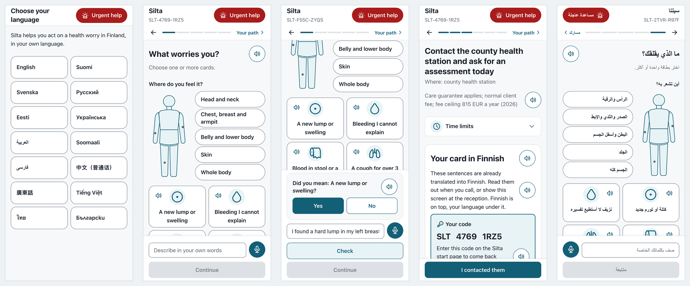
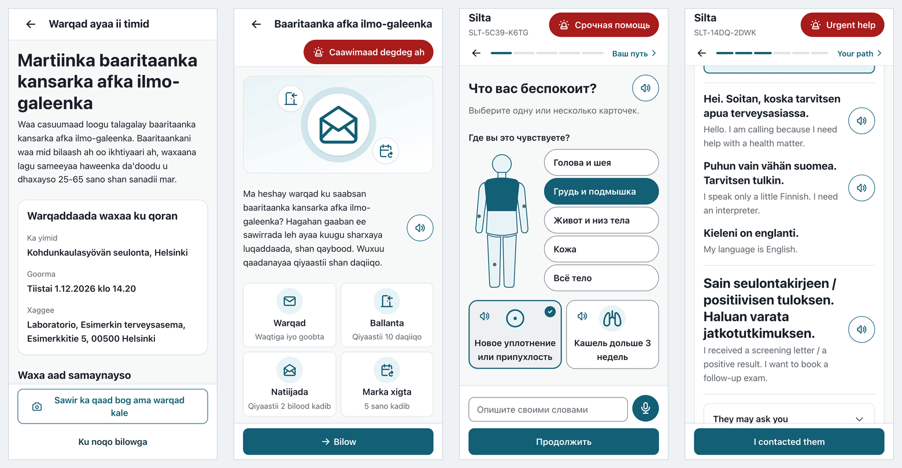
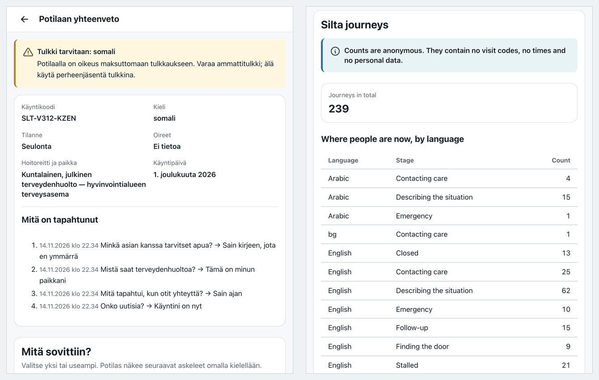
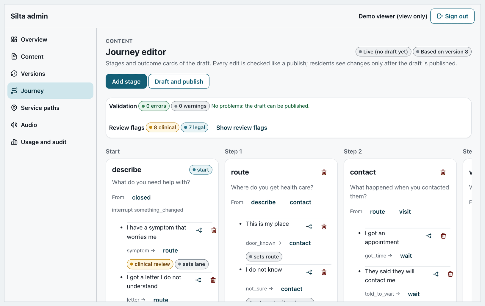
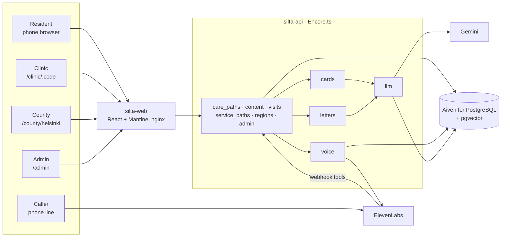

# Silta

**Equal cancer care for minorities in Finland starts before the first appointment.**

Silta (Finnish for "bridge") takes a person from a cancer symptom or a screening letter to
the right service, and to a visit both sides understand, in their own language and without
logging in. Junction 2026 · AstraZeneca challenge *Equal Care Across Finland*.

**[Project site](https://mostly-awaited-flounder.eur-1.aiven.app)** ·
**[Try it](https://mostly-awaited-flounder.eur-1.aiven.app/try)** ·
[Deck](https://mostly-awaited-flounder.eur-1.aiven.app/presentation) ·
[Video](https://mostly-awaited-flounder.eur-1.aiven.app/video) ·
[Tech partners](https://mostly-awaited-flounder.eur-1.aiven.app/tech) ·
[Live app](https://fond-useful-corgi.eur-1.aiven.app)



## Why

People with another native language attend breast, cervical and colorectal screening
**20–22 percentage points less often** than Finnish and Swedish speakers (Finnish Cancer
Registry, 2024). Closing that gap would mean about **16,500 more people screened a year**.
In lung cancer, over 50 of about 155 days pass before the first contact with care. That part
of the path happens before any register looks, and it is where Silta works.

## What it does

- **14 languages, all read aloud**: Finnish, Swedish, English, Russian, Estonian, Ukrainian,
  Arabic, Somali, Persian, Mandarin, Cantonese, Vietnamese, Thai and Bulgarian. Arabic and
  Persian right to left. An **Urgent help** button (112 / 116117) on every screen.
- **Say what worries you** by tapping a body map and picture cards, by typing or by speaking.
  Free text and speech are matched to one card and read back. Nothing is chosen until the
  person taps Yes.
- **The right service** for the person's situation and area, with **the words to say in
  Finnish**, their meaning and audio, and what to do if nobody answers.
- **A visit card** with a one-screen Finnish summary for the clinician, and the next steps back
  in the resident's language.
- **"I got a letter"**: photograph a letter you cannot read and get it explained, with the
  date and place copied as printed.
- **A phone line** for people who do not read: **+1 878 425 5777**. Press a key or say your
  language.
- **County view**: anonymous counts by journey stage, outcome and language next to public
  county figures. Never a person.

No names, ID numbers, phone numbers or emails are asked for or stored. Silta does not diagnose
or rate urgency, so it can be used today without a county contract.

## Try it

Everything below is live on Aiven and redeploys from `main`.

| | Link |
| --- | --- |
| Resident app (start here) | https://fond-useful-corgi.eur-1.aiven.app |
| County view, Helsinki | https://fond-useful-corgi.eur-1.aiven.app/county/helsinki |
| Admin (view-only demo login is shown on the sign-in page) | https://fond-useful-corgi.eur-1.aiven.app/admin |
| Phone line | +1 878 425 5777 |
| Example screening letters with QR codes, 14 languages | https://mostly-awaited-flounder.eur-1.aiven.app/try |
| API health (database + pgvector) | https://easily-smart-aphid.eur-1.aiven.app/api/health |

| In their language | Clinic and county |
| --- | --- |
|  |  |



*Admin: the whole care journey is content, not code. Editors change a draft, the validator
checks it like a publish, and residents see it only after it is published. Every text has a
review status per language.*

## Tech partners

| Partner | How Silta uses it | Detail |
| --- | --- | --- |
| **Aiven** | Three Runtime apps deploy straight from their Git commits; one Aiven for PostgreSQL database with pgvector in the same EU region holds all content, audio, anonymous visits, county figures, cost and audit rows | [docs/partners/aiven.md](docs/partners/aiven.md) · [site](https://mostly-awaited-flounder.eur-1.aiven.app/tech/aiven) |
| **ElevenLabs** | Every line read aloud in 14 languages, cached by text hash; Scribe speech input with Finnish health-care key terms where quality is good enough; a phone agent that calls the live API as tools | [docs/partners/elevenlabs.md](docs/partners/elevenlabs.md) · [site](https://mostly-awaited-flounder.eur-1.aiven.app/tech/elevenlabs) |
| **Google Gemini** | Gemini Decision 1 matches a resident's words to one card with probabilities, so Silta asks instead of guessing; Gemini 3.1 Flash-Lite explains letter photos as schema JSON; Gemini 2.5 Flash runs the phone line | [docs/partners/gemini.md](docs/partners/gemini.md) · [site](https://mostly-awaited-flounder.eur-1.aiven.app/tech/gemini) |

## Architecture



- **Encore.ts backend**, one folder per service. Endpoints stay thin,
  `service.ts` owns the rules, `repository.ts` owns SQL through the `sql` tagged template.
- **The API is the contract.** `make api` generates the typed frontend client from the
  backend; CI fails when it is stale. The frontend never hand-writes a request type.
- **One door per provider.** `backend/llm/` is the only code that calls a model and
  `backend/voice/` the only code that calls ElevenLabs. Both record cost per call and stop at
  a spend cap.
- **Content is data.** All resident text and the journey itself are one versioned document
  per release: draft, validate, publish, roll back (`docs/decisions/0003-versioned-content-document.md`).
- **One database.** Everything the product remembers is in PostgreSQL, including audio
  clips as `bytea`. Locally Encore starts its own Postgres with the same migrations.

Details: [docs/architecture.md](docs/architecture.md) · deployment:
[docs/deployment.md](docs/deployment.md) · decisions: [docs/decisions/](docs/decisions/).

### LLMs in the product: narrow, checked, confirmed

A health tool for people who may not read the language cannot afford a confident wrong
sentence. So the models in Silta never write advice and never decide urgency.

| Rule | How it is enforced |
| --- | --- |
| Models pick from a closed set, not free text | `llm.decide` returns one option plus a probability for each (`backend/llm/`) |
| Unsure means ask | Read back only at ≥ 0.55 confidence and ≥ 0.15 margin; otherwise show the cards (`backend/cards/config.ts`) |
| The person decides | Only a tap changes the journey; every match is read back first |
| Urgency stays human | Emergency options are never sent to a model; the emergency screen is the same for everyone |
| No personal data leaves | `backend/cards/redact.ts` strips identity codes, phone numbers, emails, names and addresses first |
| Every call is accounted for | One `llm_usage` row per attempt with feature, tokens, cost and latency |
| No fake answers in production | At the spend cap a call is refused, never replaced with a stub |
| Measured, cheaply | 48-case live eval: 43/43 confident answers right, 5/5 vague inputs fell back to cards, $0.005 (`docs/proof/2026-11-14/classifier-eval.md`) |

## Built LLM-first

Silta was built over the Junction weekend by a team of three working with coding agents
(Claude Code and Codex), often several at once on separate slices. The repository is designed so that an agent arriving cold
can act correctly within minutes, and so that the rules that matter are checked by machines,
not memory.

**Context is routed, not dumped.**

- [`AGENTS.md`](AGENTS.md) is the single entry point for every agent: what the project is, the
  demo path, the hard rules and where each kind of task goes. `CLAUDE.md` only imports it.
- Eight skills in `.codex/skills/` hold the repeatable procedures: task sizing, module discovery,
  backend architecture, frontend standards, LLM integration, readiness gate, demo proof, docs
  standards. `.claude/skills` is a symlink to the same folder, so Claude and Codex follow the
  same playbook.
- Every backend service and every frontend feature has its own `README.md` with its endpoints
  and tables. An agent reads the nearest README and the exact files, not the whole tree.

**Boundaries are enforced, not requested.**

| Check | What it stops | Where |
| --- | --- | --- |
| LLM boundary | A provider URL, SDK import or model ID outside `backend/llm/` | `scripts/policy/check_repo_policy.py` |
| File size | `.ts`/`.tsx` over 400 lines, `.py` over 500, so files stay readable in one pass | same |
| Secrets | Committed provider-key patterns | same |
| Docs | Docs without `Status` / `Last reviewed`, modules without a README, links to missing skills | same |
| Feature isolation | One frontend feature importing another's internals | `frontend/eslint-rules/no-cross-feature-imports.js` |
| Contract | Hand-written API request or response types | `frontend/eslint-rules/no-local-api-contract-types.js` |
| Design system | Raw styles, colours or direct Mantine imports outside `src/shared/ui` | `frontend/eslint-rules/no-raw-styles.js` |
| Generated client | A stale `client.ts` after a backend change | readiness gate |

**One gate, scoped to the change.** `bash dev_readiness_check.sh` reads `git status` and runs
only the checks the changed paths need (policy, backend typecheck and `encore test`, client
freshness, frontend lint, typecheck, unit tests and build). Changed files must have zero lint
warnings. `--all` runs everything, and
`--report-json` writes machine-readable results. CI runs `--all` on every push; only a green
gate builds and deploys.

**Proof over claims.** Agents must report what actually ran and at which level (unit, local
app, browser, deployed). User-visible flows are covered by Playwright specs in `frontend/e2e/`,
and screenshots and live-call transcripts are kept in `docs/proof/`.

**Guard rails for autonomy.** Mutating Git commands are denied to Claude in
`.claude/settings.json`; a human commits. Any paid LLM or voice run estimated above 2 € needs a
human yes first. Live provider accounts and the Aiven project are changed only with explicit
approval.

## By the numbers

| | |
| --- | --- |
| Languages, all read aloud | 14 |
| Backend services / frontend feature modules | 11 / 18 |
| Forward-only SQL migrations | 11 |
| Test files: backend / frontend unit / Playwright e2e | 25 / 25 / 9 |
| Agent skills shared by Claude and Codex | 8 |
| LLM spend for the 48-case classifier eval | $0.005 |

## Run it locally

Needs Docker, Node 24 and the [Encore CLI](https://encore.dev/docs/ts/install).

```bash
make setup          # .env from .env.example, npm ci in backend/ and frontend/
make dev-backend    # http://localhost:8300 (API under /api), dev dashboard http://localhost:9400
make dev-frontend   # http://localhost:5300
```

`encore run` starts its own PostgreSQL with pgvector and applies `backend/db/migrations`;
there is nothing else to start. Without provider keys, switch the AI and voice features to
`fake` mode (`backend/llm/providers.config.ts`, `backend/voice/providers.config.ts`).

Daily loop:

```bash
make api                          # after endpoint/type changes: regenerate the frontend client
bash dev_readiness_check.sh       # before saying "done" (scoped to changed files)
make ready                        # full gate (CI runs this on every push)
```

## Where things are

| | |
| --- | --- |
| Rules, routing, verification | `AGENTS.md`, `.codex/skills/` |
| Backend services | `backend/` (`backend/README.md`) |
| SQL migrations | `backend/db/migrations/` |
| Frontend | `frontend/` (`frontend/README.md`) |
| Generated API client | `frontend/src/shared/api/client.ts` |
| Architecture, deployment, decisions | `docs/` |
| Tech-partner write-ups | `docs/partners/` |
| Proof: screenshots, evals, call logs | `docs/proof/` |

Related repositories: the project site
([junction2026-presentation](https://github.com/madviking/junction2026-presentation)) and the
team's research knowledge base ([junction2026](https://github.com/madviking/junction2026)).

## Team

Timo Railo (product, architecture, pitch) · Mea Railo (backend, data) · Milla Railo (UX,
design, video, data storytelling).
