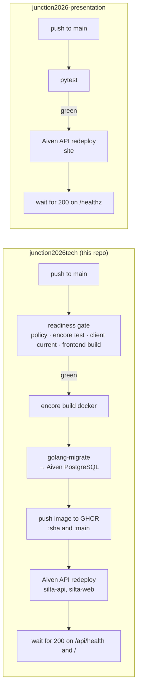

Status: active
Last reviewed: 2026-11-15

# Aiven in Silta

**A push to `main` is the release. Three Aiven Runtime apps deploy straight from their Git
commits, and one Aiven for PostgreSQL database in the same EU region holds everything Silta
must remember, without a single name, ID number or phone number in it.**

Project-site page: https://mostly-awaited-flounder.eur-1.aiven.app/tech/aiven

## What runs on Aiven

| Aiven service | What it is | From | Live |
| --- | --- | --- | --- |
| Runtime app `silta-api` | Encore.ts API (self-hosted image) | this repo, `compose.aiven.yaml` | https://easily-smart-aphid.eur-1.aiven.app/api/health |
| Runtime app `silta-web` | Resident app, clinic, county view, admin (nginx, proxies `/api/`) | this repo, `compose.web.yaml` | https://fond-useful-corgi.eur-1.aiven.app |
| Runtime app `site` | Project site: landing, deck, video, printouts, partner pages | [`junction2026-presentation`](https://github.com/madviking/junction2026-presentation), `compose.aiven.yaml` | https://mostly-awaited-flounder.eur-1.aiven.app |
| Aiven for PostgreSQL `silta-pg` | PostgreSQL 18 with pgvector, TLS only | — | `/api/health` checks the round trip and the extension |

All four run on Google Cloud `europe-west4` (Netherlands).

## From commit to production

- **Runtime builds from the commit.** Each app is linked to its GitHub repository, branch
  `main` and a compose manifest. `silta-web` and `site` build their Dockerfiles from the
  commit. `silta-api` builds `deploy/aiven/Dockerfile`, a one-line `FROM` of the image CI just
  pushed, because Runtime builds from a repository file and our API image is produced by
  `encore build docker`.
- **CI presses the button.** Runtime does not redeploy on push by itself, so the last CI job
  calls the API behind the console's **Deploy latest commit** button
  (`POST /v1/project/<project>/service/<app>/application/redeploy`) with an `AIVEN_TOKEN`
  repository secret, then polls the health checks. The same pattern runs in both repositories
  (`.github/workflows/readiness.yml` job `deploy`, and `.github/workflows/deploy.yml` in the
  site repo).
- **Schema before code.** The image does not migrate. CI applies the forward-only SQL files in
  `backend/db/migrations/` to Aiven with golang-migrate before it publishes the image, so a new
  API version never starts against an old schema.
- **Red means nothing ships.** If the readiness gate fails, no image is pushed and neither app
  is redeployed. The old version keeps serving while Runtime builds the new one.
- **Secrets stay out of Git.** The database host and CA certificate (not secrets) are in
  `backend/infra.config.json`; the password and provider keys are Runtime environment
  variables and GitHub secrets, mapped by name only.

Full runbook: [`docs/deployment.md`](../deployment.md).

## How we use the hosted PostgreSQL

One database, `silta`, is the only place product data lives. We chose one well-used service
over several thin ones.

| What it holds | How | Migration / code |
| --- | --- | --- |
| **All resident-facing text, 14 languages, versioned** | One JSON document per release in a `TEXT` column (not `jsonb`, which reorders keys and would scramble the editor's order). Admins edit a draft, publish or roll back; residents only read the published version | `3_content_releases`, `backend/content/`, `docs/decisions/0003-versioned-content-document.md` |
| **Read-aloud audio** | `bytea` rows keyed by the sha256 of the exact text, unique per text, language, voice and model. Aiven has no object storage, and clips are small, so Postgres is the blob store | `5_voice`, `backend/voice/` |
| **Anonymous visits** | A random visit code given to the resident; only a peppered hash is stored. Each tap is one row of card ids in `JSONB`, never free text | `6_visits`, `9_visit_clinician_move`, `11_visit_undo`, `backend/visits/` |
| **County view** | Public county figures next to anonymous counts by journey stage, outcome and language | `7_county_figures`, `backend/regions/` |
| **Service paths** | Doors, opening hours, interpreter rules and measured waits per area, each fact with its source | `10_service_paths`, `backend/service_paths/` |
| **Cost and audit** | Every paid AI or voice call writes a usage row with cost (`NUMERIC(16,10)`); every admin change writes an audit row | `1_llm_usage`, `8_llm_usage_cost_precision`, `4_admin` |
| **pgvector** | Installed and health-checked, reserved for the first feature that needs embeddings | `2_init_silta`, `backend/health/` |

**Same code, same schema, local and cloud.** Locally `encore run` starts its own PostgreSQL
with pgvector and applies the same migration files; tests run against it. In the cloud the
self-hosted image points at Aiven through `infra.config.json`. Nothing in the services knows
which one it is talking to.

**Same region on purpose.** Our rule is that the app and the database run in the same cloud
and region (`docs/decisions/0002-encore-ts-on-aiven.md`). From a laptop about 160 ms away, a
query took roughly 350 ms. We created the database in Finland, but Runtime does not run there,
so on 14 Nov we moved the database to `europe-west4` next to the apps. Stored data stays in the
EU.

**Why it matters here.** People are asked to trust a new tool with worries about cancer. One EU
database that holds no names or contact details, only hashed codes and card ids, makes that
promise simple to keep and simple to check, and still gives a county by-language numbers on
where people get stuck.

## Proof

| What | Level | Where |
| --- | --- | --- |
| `/api/health` answers `environment: aiven` with postgres and pgvector ok | deployed | https://easily-smart-aphid.eur-1.aiven.app/api/health |
| Every green push to `main` migrates Aiven and redeploys both apps | CI | `.github/workflows/readiness.yml` |
| Image run from a laptop against Aiven over TLS | local image | `docs/deployment.md` |
| All tables used end to end in the app and tests | e2e + `encore test` | `frontend/e2e/`, `backend/*/*.test.ts` |
