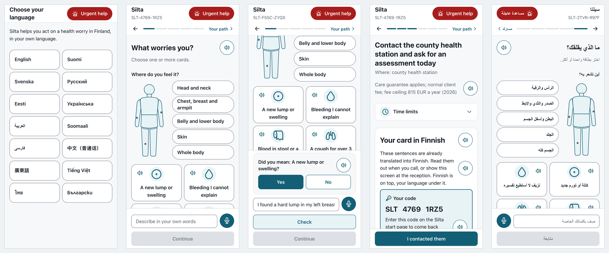

Status: active
Last reviewed: 2026-11-15

# ElevenLabs in Silta

**Every line in Silta can be heard, and most can be answered by voice, in 14 languages.
People who do not read Finnish, or read little in any language, can still follow the path.**



Project-site page with the journey view: https://mostly-awaited-flounder.eur-1.aiven.app/tech/elevenlabs

## What it does for a resident

| Need | What Silta does with ElevenLabs | Code |
| --- | --- | --- |
| "I can't read this" | A speaker button on every card, instruction and next step plays it in the resident's language | `backend/voice/service.ts`, `frontend/src/features/voice/` |
| "I don't know the Finnish words" | The call script plays the Finnish sentence, then its meaning in the resident's language | `frontend/src/features/journey/` |
| "Typing is hard" | Tap the microphone, say what you noticed. Scribe writes it down, Silta reads back "Did you mean…?" and waits for Yes | `backend/voice/stt.ts` |
| "I don't have a smartphone" | Call **+1 878 425 5777**, press a key or say your language, and an agent finds the right service in your area | `scripts/phone_agent.py` |

## How it is built

```text
tap play ──► GET /api/voice/clip?key&lang
               │ published text for (key, lang) → sha256
               ├─ approved human recording for this hash?  → serve it
               ├─ generated clip for this hash?             → serve it
               └─ else: ElevenLabs TTS once → store as bytea in PostgreSQL → serve
                                                          (Cache-Control: immutable, 1 year)

tap mic ───► POST /api/voice/transcribe → ElevenLabs Scribe (+ health-care key terms)
               → transcript → POST /api/cards/match → read-back → the person taps Yes
```

- **One boundary.** `backend/voice/` is the only code that calls ElevenLabs. Every
  request writes a `voice_usage` row with characters, seconds and cost. A 5 USD spend cap
  stops new generation; stored audio keeps playing (`backend/voice/providers.config.ts`).
- **One model, one voice, 14 languages.** `eleven_v4` covers English, Finnish, Swedish,
  Russian, Estonian, Ukrainian, Arabic, Somali, Persian, Mandarin, Cantonese, Vietnamese,
  Thai and Bulgarian. We checked the models page per language before adding it
  (`backend/voice/capabilities.ts`); older multilingual models lack Somali.
- **Generated once, never stale.** Clips are keyed by a hash of the exact published text.
  When an admin edits a text, the next play generates a new clip; the old one is never
  served again. The same text is never generated twice.
- **Voice input only where it is good enough.** Scribe's published word error rates decide
  per language. Somali is 25–50 %, so Somali voice input is refused on purpose and Somali
  speakers use picture cards with audio. The other 13 languages get voice in and out.
- **Finnish health-care words.** Each transcription sends Scribe a glossary as key terms
  (Kela-kortti, terveysasema, lähete, OmaKanta …), so "Kela card" does not come back as
  "Kellogg card". Known mishearings are fixed before matching
  (`backend/care_paths/domain/glossary.ts`).
- **Native speakers win.** In the admin, a native speaker's recording can be uploaded for
  any text. Once approved it replaces the generated clip. Generated Somali audio can never
  be marked approved; only a human recording can (`backend/voice/admin.ts`).
- **Nothing personal is kept.** Recordings and transcripts are not stored. The phone agent
  has voice recording off.

## The phone line

`scripts/phone_agent.py sync` creates the ElevenLabs agent as code: the greeting, a keypad
menu read line by line in each language (DTMF input), language detection, voice recording
off, and two webhook tools that call the **deployed** Silta API:

| Tool | Endpoint | What the caller gets |
| --- | --- | --- |
| `compose_care_path` | `POST /api/care-paths/compose` | The right service for their situation, in their language |
| `get_area_doors` | `GET /api/service-paths/areas/:area` | Opening hours, 24/7 alternatives, interpreter rules |

The agent's conversation model is Gemini 2.5 Flash ([gemini.md](gemini.md)). It reads the
Finnish sentence slowly so the caller can repeat it to the health station, and never
diagnoses.

## Proof

| What | Level | Where |
| --- | --- | --- |
| A real 108 s call in English: symptom → no residence in Finland → volunteer clinic and free interpreter → cost question | live phone call | `docs/proof/2026-11-14/phone-agent.md` |
| Keypad switch to Finnish; voice started ~1.6 s after the caller stopped | live phone call | same file |
| Simulated callers in Russian, Arabic, Ukrainian and Bulgarian, end to end against the deployed API | provider simulation | same file |
| Text-to-speech round trip in all 14 languages, with caching | live API | `docs/proof/2026-11-14/voice.md` |
| Speech-to-text in English and Finnish; Somali refused as designed | live API | same file |
| Spoken input through to the read-back in the browser | Playwright e2e | `frontend/e2e/` |

Not yet measured: whether the key terms improve accuracy on real speech.
