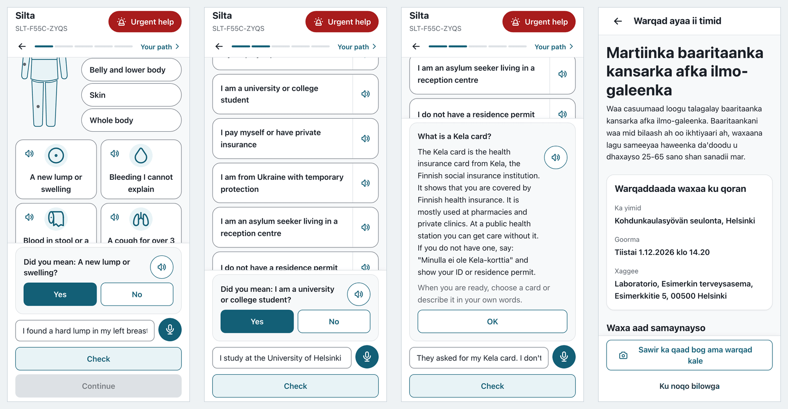

Status: active
Last reviewed: 2026-11-15

# Gemini in Silta

**Gemini turns a resident's own words into one of Silta's cards, and admits when it is not
sure. Nothing changes until the person taps Yes, and no model ever decides how urgent
something is.**

Project-site page with screenshots: https://mostly-awaited-flounder.eur-1.aiven.app/tech/gemini

## Three Gemini models, three jobs

| Job | Model | Why this model | Code |
| --- | --- | --- | --- |
| Match free text or speech to one card (symptoms, routes, outcomes) | **Gemini Decision 1** (Decisions API) | Closed-set choice with a probability per option, not free text | `backend/cards/`, `backend/llm/` |
| Explain a photographed letter in the resident's language | **Gemini 3.1 Flash-Lite** (image in, JSON schema out) | Cheap, fast, structured output | `backend/letters/` |
| Talk with callers on the phone line | **Gemini 2.5 Flash** inside the ElevenLabs agent | Low latency, tool calling | `scripts/phone_agent.py` |

## Card matching: ask instead of guess

People who have found a lump do not think in our card names. They write "I found a hard
lump in my left breast last week", "Löysin rinnasta kovan kyhmyn" or "I called three times
and nobody picked up". A chat model would answer in confident free text and could drift into
advice. For a health tool that is a safety problem.

Gemini Decision 1 picks one option from a list we send and returns a probability for every
option. Silta acts on those numbers (`backend/cards/config.ts`):

| Gemini's answer | What the resident sees |
| --- | --- |
| Top card ≥ 0.55 and ≥ 0.15 ahead of the next | "Did you mean: a new lump or swelling?" with Yes / No |
| Unsure, or two cards close | The cards themselves, no guess |
| A question about a Finnish health-care word ("What is a Kela card?") | A short reviewed answer card, ending with the Finnish sentence to say |

One call serves three journey steps: describe the symptom, find your route ("I study at the
University of Helsinki" → student health care), and report what happened ("they gave me a
time for Tuesday" → "I got an appointment") (`backend/cards/service.ts`).

**Guard rails**

- The model only ever picks a card. It never chooses the service, never sets urgency and
  never sees the emergency options; the emergency screen is the same for everyone.
- Options come only from the published, versioned content, in English and the person's
  language (`backend/cards/options.ts`).
- Before text leaves the backend, `backend/cards/redact.ts` removes visit codes, Finnish
  personal identity codes, emails, phone numbers, long numbers, self-introduced names and
  street addresses. The text is never logged or stored.

## "I got a letter"

The resident photographs a letter they cannot read. Gemini 3.1 Flash-Lite reads the photo and
answers as one JSON object that follows our schema: the letter type from a closed set, the
date, place and phone number **copied as printed**, and a short explanation with up to five
steps in the person's language. The screen labels the text as machine-made and tells the
person to check date, time and place against the paper. The photo is sent once and never
stored or logged, and text inside the photo is never treated as instructions
(`backend/letters/README.md`).

## One door to every model

All Gemini calls go through one internal Encore service, `backend/llm/`:

- `llm.decide` (closed-set choice), `llm.extract` (JSON schema, optional image) and
  `llm.complete` (text). Callers pass a **feature key** such as `cards.match`, never a model ID.
- `backend/llm/integrations.ts` is the only file that names models. Each feature entry says
  what a bad answer costs, for example "one confirmation tap".
- Every attempt, also a failed one, writes an `llm_usage` row with tokens, cost, latency and
  ids-only context.
- A spend cap (3 USD) refuses new calls. It never falls back to a fake answer: a fake decision
  would be read back to a resident as if it were real.
- The repository policy check fails the build if another folder contains a provider URL,
  SDK import or model ID (`scripts/policy/check_repo_policy.py`).

## Proof

| What | Level | Where |
| --- | --- | --- |
| 48 labelled English and Finnish inputs: 43/43 confident answers correct, 5/5 vague inputs fell back to the cards, 5/5 health-care word questions got the right answer card; total cost $0.005 | live eval | `docs/proof/2026-11-14/classifier-eval.md` |
| Card matching with read-back and fallback in the running app | browser | `frontend/e2e/`, `docs/proof/2026-11-14/journey-readback.png` |
| A Finnish invitation explained in Somali and Arabic | local app | `docs/proof/2026-11-14/letter-result-so.png`, `letter-result-ar.png` |
| Gemini 2.5 Flash running a real phone call against the deployed API | live phone call | `docs/proof/2026-11-14/phone-agent.md` |
| Live smoke calls for `decide` and `complete` | live API | `backend/llm/README.md` |

The labelled set was written by the builders, so it shows the wiring and the guard rails, not
an independent accuracy figure. The letter flow was tried on our example letters, not on real
letters.
